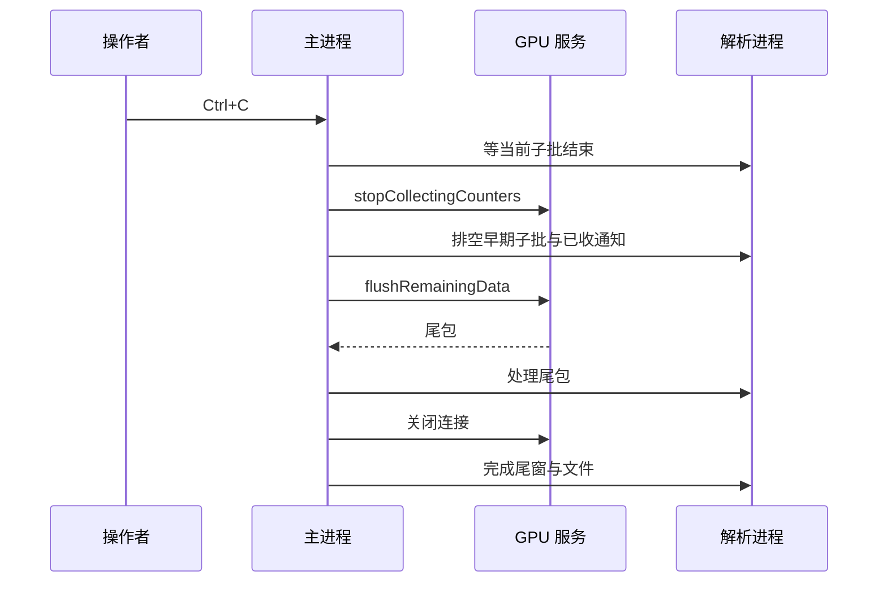

# 从零理解 iOS GPU Counter：通信、计算与结果

本文说明工具如何工作，不需要先了解 DTX、GPU 计数器或异步编程。所有演算例子都是**合成数据**，只用于解释协议和代码；没有把某个设备的字段、时钟或核心数量作为通用公式。

运行方法见 [README](../README.md)，错误处理与 Debug 用法见 [USAGE](USAGE.md)，完整文件定义见 [OUTPUT_FORMAT](OUTPUT_FORMAT.md)。

建议先顺序读 1～5 节，建立“连接 → 原始值 → 指标 → 文件”的完整认识；6～8 节按指标或游戏问题查阅；第 9 节提供源码阅读路线。

## 1. 先看完整流程

工具不直接访问 GPU 寄存器，也不向游戏插入采集代码。它通过 pymobiledevice3 调用设备 GPU 服务：先取得字段定义和 JS 公式，再接收采样字节，在电脑上执行公式并按秒输出。


先记住三个对象：

| 对象 | 可以理解成 | 提供什么 |
|---|---|---|
| 元数据 metadata | 表格的字段说明与计算规则 | 指标名称、原始字段顺序、JS 函数和参数 |
| 原始采样 raw samples | 尚未换算的仪表读数 | 时间戳及按固定顺序排列的整数 |
| 解析结果 parsed results | 按规则算好的指标 | 每项 Counter 的数值、时间窗口与质量 |

设备负责给出**数据与指标公式**；Python 负责**通信、解释字段、准备输入、执行公式和汇总**。这两部分不能混淆：不是所有计算都由 JS 完成，但 Python 也不会按机型重新编写指标公式。

结果是全设备 GPU 数据，不能直接归因到某个游戏、Pass 或 Draw Call。工具只生成数据；本文的分析方法由使用者在其他工具中执行。

## 2. Windows 如何连到设备

### 2.1 每一层的作用

| 层次 | 通俗解释 | 实现责任 |
|---|---|---|
| USB 与 Apple 通信组件 | 连接电脑和手机的道路 | Windows 驱动/系统组件 |
| usbmux | 在多个设备及设备服务之间转接连接 | pymobiledevice3 |
| lockdown | 确认信任、查询设备信息、建立服务连接 | pymobiledevice3 |
| 隧道与 RSD | 为较新系统提供开发者服务通道，并查询服务端口 | pymobiledevice3 |
| DVT / DTX | 用消息发送方法调用、接收回复和通知 | pymobiledevice3 |
| GPU Counter 服务 | 提供 GPU 信息、元数据和采样 | 设备服务；本工具封装调用 |

这些是协议职责，并不是每一层都启动一个独立进程。当前工具按 UDID 或唯一 USB 设备选择目标；再根据系统版本使用库的 lockdown 或 RSD 隧道路径。版本决定连接方式，不决定 Counter 公式。库支持某条路径也不等于本工具已经验证所有设备。

`DvtProvider` 建立 DTX 连接后，通过 `open_channel(GpuService)` 打开 GPU 逻辑通道：

```text
com.apple.instruments.server.services.gpu
```

逻辑通道用于在同一 DTX 连接中区分服务，不应当成另一个 USB 设备或独立网络端口。

### 2.2 Python 方法如何变成设备请求

源码中的声明如下：

```python
@dtx_method("requestDeviceGPUInfo")
async def device_info(self): ...
```

这里 `...` 不代表什么都没做。装饰器将调用映射为 DTX 请求，selector `requestDeviceGPUInfo` 是设备方法名：

```text
await service.device_info()
  → 库编码方法名和参数
  → 经 DTX 发送到 GPU 通道
  → 设备返回回复
  → 库解码并唤醒等待者
  → Python 得到 list/dict 等对象
```

初始化依次执行：选设备 → 连接 DVT → 打开 GPU 通道 → `requestDeviceGPUInfo` → 查询 Mach 时间基准 → 配置 Counter。DeviceInfo 只负责初始化时间查询，持续采样由 GPU Counter 服务完成。

### 2.3 请求回复与采样通知是两条逻辑路径

| 方法 | 用途 |
|---|---|
| `requestDeviceGPUInfo` | 查询 GPU、accelerator-id 和支持的 profile |
| `configureCounters:counterProfile:interval:windowLimit:tracingPID:` | 配置本次采集 |
| `startCollectingCounters` | 开始采样 |
| `stopCollectingCounters` | 停止采样 |
| `flushRemainingData` | 停止后取回尾部 |

当前固定参数为 profile=3、interval=0、windowLimit=-1、tracingPID=-1。它们是服务协议值，不代表“一秒采一次”，也没有选择目标游戏 PID。工具会检查设备报告的支持情况，不能自动确定唯一 GPU 或 profile 不支持时明确报错。

`await service.start()` 等待的是启动回复。元数据和采样通过通知回调独立到达：

```python
@dtx_on_notification
async def notification(self, payload):
    self.enqueue(payload)
```

通知放进主进程队列，随后交给解析工作进程。设备主动分批推送，工具没有每秒发一次“取样”请求。等待多久与设备批次有关，一秒输出窗口也不是网络发送频率。

## 3. 一组元数据，怎样对应一条采样

### 3.1 元数据的四部分

当前解析器支持的 GPU 通知主体形如 `[kind, ..., ..., count, body]`。`kind=0` 是元数据，`kind=1` 是二进制采样；部分短控制通知只用于控制，不参与计算。这些已经是库解码后的服务对象，不是原始 USB/DTX 帧。

元数据主体的字典键含义如下：

| 键 | 内容 | 代码中的去向 |
|---|---|---|
| `0` | 最终指标定义 | `Decoder.counters` |
| `1` | 原始字段名称、顺序与处理标记 | `Decoder.raw_fields` |
| `2` | JS 源码字符串 | `FormulaEngine` |
| `3` | GPU 参数 | JS 全局变量 |

设备的字段名可能是难以阅读的长标识。它来自元数据，不由工具计算或反推；同一个标识连接了“元数据里的字段”“采样数组中的位置”和“JS 使用的变量”。

### 3.2 通用合成例子

假设某个**虚拟设备**提供这三个原始字段：

```text
raw_fields[0] = ["GRC_GPU_CYCLES", false]
raw_fields[1] = ["work", false]
raw_fields[2] = ["active", true]
```

`true` 表示主机直接使用当前读数，不做普通累计差分；`false` 的普通字段需要前后相减。`GRC_GPU_CYCLES` 等协议上下文字段另有直接取值规则，不能因为标记为 false 就相减。

一条二进制记录为：

```text
timestamp | GRC_GPU_CYCLES | work | active
```

每个数占 8 字节，是小端 uint64，因此这个例子每条为 32 字节。真实记录长度始终按元数据计算：

```text
每条字节数 = (原始字段数 + 1) × 8
整包字节数 = count × 每条字节数
```

Python 解包后执行 `timestamp, *raw = row`。于是 `raw_fields[i]` 对应 `raw[i]`；保留的 `previous` 是包含时间戳的完整上一条记录，对应值在 `previous[i+1]`。这就是差分时下标加一的原因。

### 3.3 原始读数先变成公式输入

假设前后两条记录如下，时间戳暂用 T0/T1 表示：

| 记录 | 时间戳 | cycles | work | active |
|---|---|---:|---:|---:|
| 上一条 | T0 | 100 | 1000 | 12 |
| 当前条 | T1 | 100 | 1040 | 20 |

`Decoder._prepare_formula_inputs()` 得到：

```text
GRC_GPU_CYCLES = 100          协议字段，直接取当前值
work = 1040 - 1000 = 40      普通累计字段，求增量
active = 20                 true 标记，直接取当前值
```

同一解析器保留跨包前值，第二包首条可以用第一包末条做差分。首条公式采样只能建立基线，完全重复记录不重复计算。

### 3.4 `_norm` 是 Python 生成的变量

主机同时保留上述值，并生成：

```text
work_norm = work / GRC_GPU_CYCLES = 40 / 100 = 0.4
active_norm = active / GRC_GPU_CYCLES = 20 / 100 = 0.2
```

`_norm` 不是设备又发了一组字段，也不是 JS 自动给变量加后缀。它是 Python 新增的“按当前周期字段归一化”的输入。它不一定在 0～1 之间，不直接等于百分比；JS 可以选择原值、差分值、`_norm` 或时间上下文，并非每个指标都使用 `_norm`。

`GRC_GPU_CYCLES` 随当前样本传入，不是 GPU 主频或主机接包间隔。当前解析器要求它为正数；设备元数据不足以证明该字段覆盖所有经过周期还是仅活跃周期，不能进一步推断。

## 4. 从 JS 返回值到一秒结果

### 4.1 JS 执行与显示缩放

继续使用合成例子，虚拟设备的显示定义为：

```text
["Demo Utilization", 100, "合成示例 / Synthetic example", "demo", 100, 0]
```

依次对应名称、上限、说明、函数名、缩放倍数；末尾未使用字段不猜测含义。其 JS 为：

```javascript
function demo() {
    return work_norm;
}
```

QuickJS 执行后返回 0.4；Python 根据设备定义执行：

```text
显示值 = min(max(JS 返回值 × scale, 0), maximum)
       = min(max(0.4 × 100, 0), 100)
       = 40
```

这个 40 是**一条样本**的指标值。字段名字、函数、缩放和上限都来自元数据；不会因看到 Utilization 就自行乘 100，也不会使用某个机型的核心数或时钟常量。

### 4.2 时间与带宽没有统一的机型常量

设备时间戳通过查询得到的 Mach 比例换算：

```text
相对秒数 = (当前 timestamp - 首条 timestamp) × numer / denom / 1e9
采样间隔纳秒 = (当前 timestamp - 上一条 timestamp) × numer / denom
```

主机将这些时间上下文与变量传给 JS。带宽的含义是数据量除以时间，但具体字节换算系数、时间分母及所用原始字段由设备 JS 决定，不在 Python 中硬编码。也不把设备攒包的等待时间作为带宽分母。

### 4.3 一秒一行：有效样本算术平均

样本按设备相对结束时间进入 `[k, k+1)`；边界样本归下一窗口。若某项指标在同一窗口的有效值为 20、40、60，输出均值为 40。每项指标有独立有效分母，正常零值计入，缺失不补零。

这是**样本等权平均**，不是时间加权平均。即使某项叫 Count，导出值也不是该秒事件总次数。最后不足一秒的尾窗只到最后观测时间，不虚构完整覆盖。

| 输出 | 时间与数值 |
|---|---|
| CSV | time_ms 为窗口起点毫秒；随后为 Counter 原名列；缺失空单元格 |
| JSON | 秒单位窗口及 values，附带质量/分母/结束状态；缺失 null |
| 终端 | 每窗口一个 key: value 的 JSON 行，指标在 values 中；来自同一 WindowRecord |

### 4.4 异常时怎么处理

| 情况 | 行为 |
|---|---|
| 累计字段出现负差分 | ERROR 提示并跳过整条，不猜位宽、不自动修正回绕；后续递增数据继续 |
| 时间倒序或同时间戳异常 | 跳过且不替换差分基线 |
| 无效周期或不安全整数 | 跳过，不把错误替换成零 |
| 单个 JS 函数失败/非有限值 | 该项缺失，其他有效指标仍可保留 |
| 元数据改变、布局无法解释、断连、写盘失败 | 按停止保护完成已有结果，不冒险继续解释 |

`partial` 表示有可用数据但不完整；`failed` 表示没有有效结果；正常不足一秒尾窗本身不导致 partial。错误计数会保留，重复提示按类型限频。完整规则见 [输出契约](OUTPUT_FORMAT.md)。

## 5. 为什么使用异步和独立进程

### 5.1 `await` 不等于乱序执行

连接、配置、启动仍按代码顺序执行。`await service.stop()` 只是让当前流程等待回复，此时事件循环还能接收设备通知、检查超时或响应停止事件。当前库的通信接口本身也是异步的。

计算和写盘并不是“异步就会更快”。工具把它们隔离到进程中：

| 执行位置 | 负责什么 | 为什么这样分 |
|---|---|---|
| 主进程事件循环 | 设备连接、DTX 接收、停止与超时 | 等回复时仍能接收通知 |
| 解析子进程单线程 | Decoder、QuickJS、窗口、结果文件及终端数据 | 保证 JS 线程约束，阻塞时可终止进程 |
| 可选 Debug 子进程 | 元数据、JS、二进制与消息索引 | 原始文件写入不阻塞接收回调 |

接收队列有消息数/字节预算；解析批次最多按 512 条拆成主机任务，每次只等一个请求完成。这是主机工作划分，不改变设备采样频率。原始 Debug 记录发生在拆分/解析之前。

### 5.2 停止后为什么要取尾



不能直接杀进程：手机端可能还有未推送数据。也不能正常录制期间周期 flush 来假装每秒实时刷新。拔线后无法取回设备未发出的内容，因此只保留主机已有结果并标明 partial。底层同步 OS 调用完全卡死不属于 asyncio 超时可强制打断的保证范围。

### 5.3 Debug 保存的“原始”到哪一层

开启 `capture --debug` 后，`captures/<本次时间戳>/debug/` 保存服务载荷：元数据、原文 JS、原始采样字节、控制通知和 RPC 回复。它们已经过库的 DTX 解码，**不是 USB/DTX 帧抓包**。被过滤的采样仍能在原始字节中找到。

JSON 类型标记与 bin 引用用于避免整数键、大整数和二进制失真。closed 只表示已接受记录写入结束，不表示设备采集完整。Debug 增加磁盘及计算开销，正常使用默认关闭。路径与阅读方式见 [Debug 使用说明](USAGE.md#debug-原始数据保存)。

## 6. 指标字典：这些数据能帮助判断什么

先分清五类量：Limiter 是某条路径工作/停顿的限制线索，Utilization 是对应路径实际利用程度，Occupancy 是并发 SIMD 组相对容量，Bandwidth 是单位时间的数据量，Count 是事件量。它们不是同一种“GPU 使用率”，不能相加成一个总值。

Occupancy 不是显存占用；带宽也不是内存容量。高值可以说明工作很多，也可能反映低效；低值可能是工作不足或在等待。要与具体工作负载及外部 GPU 耗时共同判断。没有按字段数值直接认定瓶颈的通用阈值。

以下列举已遇到的指标名称及其设备说明，不是每台设备都必须支持的固定清单。请通过 counters 命令查看当前设备的实际定义。表中的“候选问题/核实方法”是结合游戏工作负载提出的调查假设，不是设备元数据保证的根因，也不是本工具生成的诊断结论。没有跨游戏通用的“超过 80 就异常”阈值。

### 6.1 算术与精度：4 项

| Counter | 含义与用途 | 游戏中的候选问题与核实方法 |
|---|---|---|
| `ALU Limiter` | 算术逻辑工作相关的限制程度，设备描述涉及相对峰值能力的尝试执行时间 | 复杂光照、材质或计算核。简化对应计算，核对 GPU 时间是否下降，而不是只追求该值下降 |
| `ALU Utilization` | ALU 实际利用程度，与 Limiter 配合观察 | 区分大量有效算术活动与可能的效率限制；不能从它区分是 Vertex 还是 Fragment 算术 |
| `F32 Utilization` | 32 位浮点执行路径的利用程度 | 高精度运算较活跃时，检查哪些变量确需精度；在可接受范围试验 half，并验证画质和数值误差 |
| `F16 Utilization` | 16 位浮点执行路径的利用程度 | 辅助核对精度调整后的工作特征；值升高本身不等于优化成功，最终仍看耗时和结果正确性 |

不要把 `F16/F32` 当作源码中 half/float 变量的百分比；编译结果和实际运行路径才决定执行活动。也不要为了降低 ALU 数值将工作搬到已经受限的纹理路径。

### 6.2 纹理采样、过滤与写入：6 项

| Counter | 含义与用途 | 游戏中的候选问题与核实方法 |
|---|---|---|
| `Texture Sample Limiter` | 纹理采样路径的限制相关程度 | 多层材质、阴影采样、后处理反复取样；逐项减少采样或关闭对应效果，检查时间变化 |
| `Texture Sample Utilization` | 纹理采样的实际利用程度 | 与采样 Limiter 联看，确认取样工作特征；它不是每帧采样次数 |
| `Texture Filtering Limiter` | 纹理过滤路径的限制相关程度 | 过滤设置或输入纹理格式可能影响开销；固定其他条件改变过滤方式并复测 |
| `Texture Cache Limiter` | 纹理缓存路径相关指标；已有设备定义文字只给出简短名称 | 可调查纹理访问局部性、工作集变化；不能直接读作 cache miss rate，需要更细粒度计数器确认 |
| `Texture Write Limiter` | 纹理写入路径的限制相关程度；已有设备定义描述较简略 | Render Target、后处理输出或显式纹理写入；改变输出分辨率、格式或 Pass 组织作对照 |
| `Texture Write Utilization` | 纹理写入实际利用程度 | 辅助确认写路径活动，不代表所有读写都已到 DRAM；与写带宽及对应 Pass 同看 |

这里的调整是实验变量，不是应一律降低的画质选项。Apple 对纹理读写路径、过滤和像素格式的关系有专门说明，可参考 [GPU Counter 介绍](https://developer.apple.com/videos/play/wwdc2020/10603/)；本工具未提供纹理资源或 Pass 的直接归因。

### 6.3 Buffer 读写：4 项

| Counter | 含义与用途 | 游戏中的候选问题与核实方法 |
|---|---|---|
| `Buffer Read Limiter` | Buffer 加载路径的限制相关程度 | 顶点属性、骨骼数据、实例数据、计算输入读取；调整数据布局或访问模式，观察相关 Pass |
| `Buffer Load Utilization` | Buffer 加载的实际利用程度 | 判断读 Buffer 工作是否随人数、实例数量或计算规模变化；它不是读字节数 |
| `Buffer Write Limiter` | Buffer 存储路径的限制相关程度 | 粒子更新、剔除列表、计算输出等写入；缩减输出或改变算法后核对耗时 |
| `Buffer Store Utilization` | Buffer 存储的实际利用程度 | 与写 Limiter、外部写带宽交叉观察；不能单独判断存在原子操作冲突或寄存器溢出 |

同一资源访问可能命中缓存，Buffer 利用程度与外部带宽不必同比增长。若怀疑寄存器溢出或原子操作，应继续查具体 Shader 的编译统计和指令，而不是把 Counter 的升高直接命名为这些原因。

### 6.4 Threadgroup / Imageblock：4 项

| Counter | 含义与用途 | 游戏中的候选问题与核实方法 |
|---|---|---|
| `Threadgroup/Imageblock Load Limiter` | 线程组和 imageblock 加载路径的限制相关程度 | 使用局部共享数据的计算核、Tile 相关算法；检查读取次数和访问组织 |
| `Threadgroup/Imageblock Load Utilization` | 对应加载路径实际利用程度 | 确认局部读活动随算法规模的变化；不代表外部内存带宽 |
| `Threadgroup/Imageblock Store Limiter` | 线程组和 imageblock 存储路径的限制相关程度 | 局部中间结果、共享累加或相关图像操作；用简化算法对照，但不能单凭此值认定同步冲突 |
| `Threadgroup/Imageblock Store Utilization` | 对应存储路径实际利用程度 | 确认局部写活动变化；需结合具体代码区分计算共享内存和图像操作 |

这组指标同时覆盖 Threadgroup 与 Imageblock，不能看到它们升高就认定一定是 Compute Shader。Threadgroup 内存的“访问活动”与“分配容量”也是不同量，不能用这些值计算分配了多少 KB。路径背景见 [Reducing shader bottlenecks](https://developer.apple.com/documentation/xcode/reducing-shader-bottlenecks)。

### 6.5 片元输入插值：2 项

| Counter | 含义与用途 | 游戏中的候选问题与核实方法 |
|---|---|---|
| `Fragment Input Interpolation Limiter` | 顶点输出到片元输入的插值路径限制相关程度 | 材质传递多个 UV、颜色、方向等 varying；缩减不必要输入，核对相应 Pass |
| `Fragment Input Interpolation Utilization` | 插值路径实际利用程度 | 辅助确认片元输入工作变化；不是三角形数、像素数或 overdraw 倍率 |

输入数量减少可能改变其他阶段的计算量，应观察整体时间，不能只根据插值指标下降决定优化有效。

### 6.6 缓存、MMU 与外部带宽：6 项

| Counter | 含义与用途 | 游戏中的候选问题与核实方法 |
|---|---|---|
| `GPU Last Level Cache Limiter` | GPU 末级缓存服务读写请求的限制相关程度 | 大工作集或集中读写；比较纹理/Buffer 活动和外部带宽，再缩小到资源使用场景 |
| `GPU Last Level Cache Utilization` | GPU 末级缓存实际利用程度 | 观察缓存路径活动，不是缓存占用大小或命中率 |
| `MMU Limiter` | 设备描述为末级缓存未命中后，通过 MMU 执行读写请求的限制相关程度 | 可调查外部访问压力及访问模式；不是页故障次数，也不能直接认定内存不足 |
| `MMU Utilization` | 对应 MMU 请求路径实际利用程度 | 与 LLC 和外部带宽联合观察，不能用二者相减计算页表开销 |
| `GPU Read Bandwidth` | 从 GPU 外部内存读取的速率，设备文字单位 GB/s | 大纹理、多输入后处理、几何/计算数据读取；调整单类资源后比较 GPU 时间和读带宽 |
| `GPU Write Bandwidth` | 向 GPU 外部内存写入的速率，设备文字单位 GB/s | 中间渲染目标、计算输出等写入；检查是否需要这些结果及其存储方式 |

LLC 活动高并不要求外部带宽也高，缓存可以吸收访问；反之，带宽低也不能排除延迟或不规则访问限制。Apple 建议在具体工作上下文中检查带宽与其他限制指标，见 [Measuring the GPU’s use of memory bandwidth](https://developer.apple.com/documentation/xcode/measuring-the-gpus-use-of-memory-bandwidth)。不要把本工具的 GB/s 与芯片宣传的整机峰值相除后直接称为“GPU 内存利用率”。

### 6.7 阶段并发与部分渲染：4 项

| Counter | 含义与用途 | 游戏中的候选问题与核实方法 |
|---|---|---|
| `Vertex Occupancy` | 顶点 Shader 并发 SIMD 组相对 GPU 最大并发容量 | 人物、网格、实例或顶点处理变化的线索；用引擎顶点统计和具体 Pass 时间确认，不直接推算面数 |
| `Fragment Occupancy` | 片元 Shader 并发 SIMD 组相对最大容量 | 分辨率、材质、透明效果变化的线索；不等于填充率或 overdraw，也不代表片元阶段占帧时间比例 |
| `Compute Occupancy` | 计算 Shader 并发 SIMD 组相对最大容量 | 粒子、剔除、图像计算等并发活动；需要具体 dispatch 才能确认低并发原因 |
| `Partial Renders Count` | 设备定义的 encoder 内部分渲染次数，导出为有效样本均值 | 持续非零或随功能变化时，进一步查看对应渲染 Pass；仅凭已有设备定义短描述不能确定触发原因，更不能等同于掉帧、Pass 数或内存溢出次数 |

三个 Occupancy 分别描述对应阶段的并发占用程度，应结合各自的工作负载解读。进一步说明见 [GPU occupancy](https://developer.apple.com/documentation/xcode/finding-your-metal-apps-gpu-occupancy)。

## 7. 如何用于具体游戏问题

下面都是**假设驱动的排查方法**，不是已在本项目测出的某款游戏问题。“耗时/帧率”来自外部工具，Counter 只提供关联线索。

| 现象 | 优先组合观察 | 一次只改变一个条件 | 如何确认或否定 |
|---|---|---|---|
| 团战、烟雾或透明特效出现时变慢 | Fragment Occupancy、ALU、纹理采样、局部读写、外部带宽 | 固定镜头，关闭一类效果或降低其覆盖面积 | 具体效果 Pass 变快才支持该方向；Counter 不直接证明 overdraw |
| 高画质材质明显更慢 | ALU Limiter/Utilization、F32/F16、纹理 Sample/Filtering | 单独替换材质计算或单独减少采样 | 看 Shader/Pass 时间及画质；精度改变可能带来数值问题 |
| 人物或实例增加后变慢 | Vertex Occupancy、Buffer Read/Load、读带宽，同时看 Fragment | 固定显示分辨率，改变 LOD 或实例数 | 用顶点工作量和 Pass 时间确认；阴影、片元和 CPU 提交也可能一起增加 |
| 开启 Bloom、模糊或其他全屏处理后变慢 | 纹理 Sample/Write、GPU Read/Write Bandwidth、ALU | 单独降低该效果的中间目标分辨率或减少一次处理 | 看对应 Pass 时间；不能把所有变化一概归为“带宽瓶颈” |
| GPU 粒子、剔除或计算核效率低 | Compute Occupancy、Buffer、Threadgroup/Imageblock、ALU | 单独改变线程组配置、共享数据方案或工作规模 | 结合 dispatch 时间和编译统计；低 Occupancy 不能单独证明寄存器不足 |
| 场景切换时卡顿但 Counter 不高 | 先检查数据质量，再看全体 Counter 是否低活动 | 保持同一场景重复运行，比较外部 CPU/GPU 时间线 | 可能涉及 CPU、加载、编译、同步或短尖峰被均值稀释；本工具不能从低值直接判定 CPU 瓶颈 |

### 一个完整示例：全屏效果开关

假设外部测得：固定镜头下开启某全屏效果后 GPU 帧时间变长，秒级读写带宽、纹理采样和写入活动也随之增加。

1. 先确认两次采集都完整，设备、分辨率、帧率上限和负载条件相同。
2. 提出候选：“该效果增加了纹理访问和输出工作”，暂不命名为某条硬件路径饱和。
3. 保持采样次数不变，只把该效果中间目标改为半宽半高；另一轮保持分辨率不变，只减少采样次数。
4. 用外部工具对照具体 Pass 时间，判断哪个改变影响最大，同时确认图像质量。
5. 若 FPS 原本封顶，优化后 FPS 可能不变；应看 GPU 时间是否缩短，不能因 FPS 不变就否定收益。

这些实验用 Counter 观察工作特征，再用外部耗时验证具体 Pass 的变化。进一步定位方法可参考 Apple 的 [Metal 性能分析流程](https://developer.apple.com/documentation/xcode/analyzing-the-performance-of-your-metal-app)。

## 8. 正确组织一次数据分析

1. **固定比较条件**：同设备、系统、游戏版本、镜头/操作、分辨率、画质和帧率上限。记录设备温度与后台状态，避免把环境变化当成功能变化。
2. **选择输出**：常规导表用 CSV；排查数据质量用 JSON。终端默认只显示 6 项重点指标，不能把终端没显示的项当作没采到。
3. **先看完整性**：检查退出码、stderr、会话状态；JSON 再看异常数和有效分母。CSV 空格不能按 0 参与统计。
4. **对齐真实操作区间**：`time_ms` 从设备首样本开始，终端显示存在批次延迟。不要以“看到一行时的主机时刻”标注游戏事件；跨工具需要独立对齐依据，不能声称默认帧级同步。
5. **先定位持续区间，再联合看指标**：从 Occupancy、Limiter/Utilization 和读写带宽组合提出候选。不要对混合多个场景的全场均值直接排名根因。
6. **一次改一个因素，并复测耗时与画质**：必要时转到 Xcode/引擎 Profiler 定位 Pass、dispatch 或 Shader。结论应同时写观察、假设和验证结果。

一秒均值适合观察持续变化，短尖峰可能被平均稀释；分析单帧异常时，应结合外部逐帧数据。

## 9. 如何阅读源码

主文件 [ios_gpu_counter.py](../ios_gpu_counter.py) 按职责分区，入口在末尾。第一次阅读不必从 import 开始逐行读，建议沿以下路线：

| 顺序 | 符号 | 先回答这个问题 |
|---|---|---|
| 1 | `main` / `build_parser` | 用户选了哪个命令，输出到哪里？ |
| 2 | `live` | 什么时候创建连接/进程，失败后谁负责清理？ |
| 3 | `connect_device` / `prepare_gpu` | 如何使用库找到并配置 GPU 服务？ |
| 4 | `GpuService` / `collect_parsed` | 回复与通知如何进来，如何开始和结束？ |
| 5 | `ParsedPipeline` | 哪条消息是元数据，哪条是样本？ |
| 6 | `Decoder.metadata` / `Decoder.samples` | 字段如何绑定，二进制如何解包？ |
| 7 | `_prepare_formula_inputs` / `_evaluate_counters` | 哪些值差分、如何生成 _norm、如何调用 JS？ |
| 8 | `WindowAggregator` / `ResultWriter` / `WindowOutput` | 怎样按秒平均，怎样保证文件和终端一致？ |
| 按需 | `CaptureWorker` / `stage_wait` / `run_capture` | 进程通信、超时与退出如何保证有界？ |
| 按需 | `DebugRecorder` / `DebugArchive` | 原始数据在哪里被记录和写盘？ |

源码中标注的“已验证设备”只是既有验证范围，不选择数值公式，也不拦截其他设备。理解通用算法时不需要依赖该标签；真实适用范围见 [使用说明](USAGE.md#兼容性与已知限制)。

## 10. 继续阅读

- [输出格式](OUTPUT_FORMAT.md)：对接 CSV/JSON/Debug 文件时查字段，避免重复猜测。
- [pymobiledevice3](https://github.com/doronz88/pymobiledevice3)：通信库；本工具固定版本，在线主分支可能不同。
- [Apple GPU Counter 介绍](https://developer.apple.com/videos/play/wwdc2020/10603/)：理解 GPU 架构与计数器类别。
- [Reducing shader bottlenecks](https://developer.apple.com/documentation/xcode/reducing-shader-bottlenecks)：理解各执行路径的 Limiter/Utilization。
- [GPU occupancy](https://developer.apple.com/documentation/xcode/finding-your-metal-apps-gpu-occupancy)：理解并发量及资源约束。
- [GPU memory bandwidth](https://developer.apple.com/documentation/xcode/measuring-the-gpus-use-of-memory-bandwidth)：区分带宽与内存容量。
- [Metal 性能分析流程](https://developer.apple.com/documentation/xcode/analyzing-the-performance-of-your-metal-app)：用更细的时间线继续定位，界面随工具版本变化。

服务连通与数值准确性需要分别确认，实际验证范围见 [使用说明](USAGE.md#兼容性与已知限制)。
