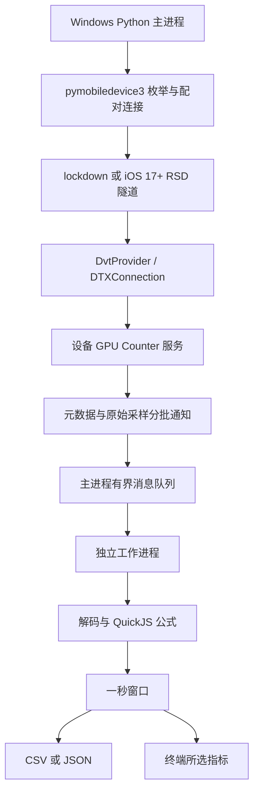
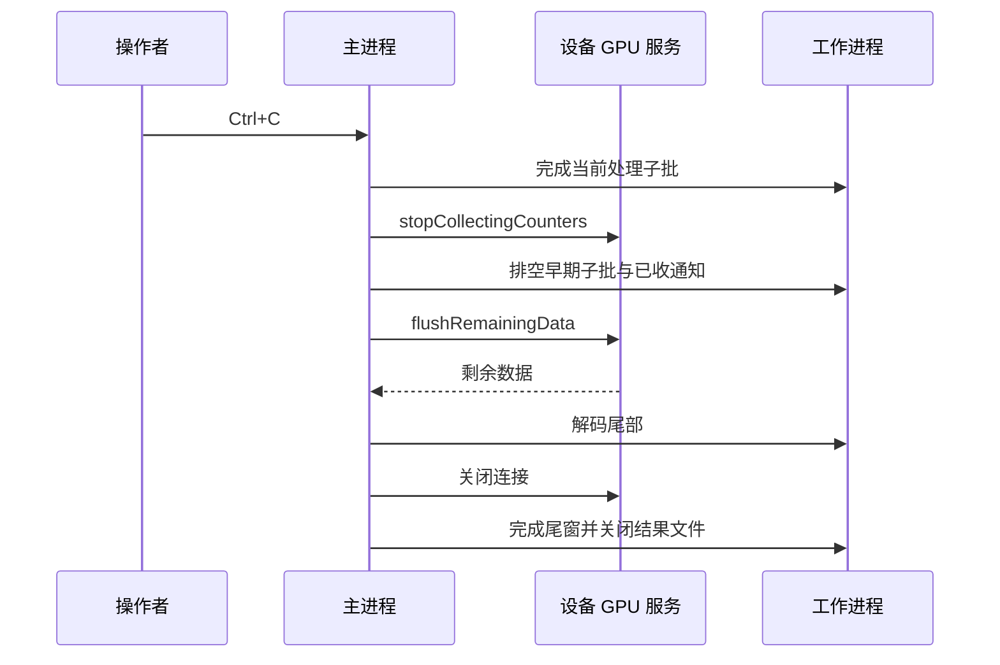

# iOS GPU Counter 采集技术说明与游戏性能排查指南

更新：2026-11-10。实现基线：Windows x64、Python 3.12、pymobiledevice3 11.39.0、quickjs-ng 0.18.0.1；现场验证设备为 iPhone 13 Pro / A15 / iOS 18.5。

本文按“指标是什么 → 从哪里获取 → 如何计算 → 如何实现 → 如何用于排查”展开。

工具负责采集和导出数据；本文介绍人如何解读这些数据，不表示工具新增了自动分析、图表或瓶颈判定功能。

## 阅读路线

| 想了解的问题 | 建议阅读 |
|---|---|
| 这些数据能帮我做什么？ | 第 1–2 节：能力与概念 |
| Windows 如何读到 iPhone 的 Counter？ | 第 3 节：设备通信与协议 |
| CSV 中一个数字是怎么算出来的？ | 第 4–5 节：解码、公式与聚合 |
| 30 个字段分别有什么用？ | 第 6 节：逐项指标说明 |
| 掉帧、特效、材质和带宽问题如何排查？ | 第 7–8 节：场景与验证流程 |
| 如何继续维护代码、判断结果可信度？ | 第 9–10 节：可靠性与源码导航 |

使用命令见 [README](../README.md)，文件契约见 [OUTPUT_FORMAT](OUTPUT_FORMAT.md)，兼容范围与已知限制见 [使用说明](USAGE.md#兼容性与已知限制)。

## 1. 工具提供的是什么

游戏一帧变慢，可能发生在 CPU 提交、顶点处理、像素着色、纹理访问或内存读写等不同环节。GPU Counter 提供 GPU 内部不同工作路径的活动线索，帮助缩小调查范围。

例如，开启某个后处理后，外部帧时间明显变长，同时纹理采样和读带宽指标持续升高，可以优先检查该后处理的采样次数和输入资源。这里得到的是“值得验证的方向”，不是自动证明某个 Shader 有问题。

本工具输出有四个重要属性：

1. **全设备范围**：包含采样期间设备 GPU 上的工作，不按游戏 PID、渲染 Pass 或 Draw Call 归因。后台图形活动、系统合成也可能影响结果。
2. **设备动态定义**：名称、原始字段、公式来自设备。当前基线返回 30 个指标，但代码没有把 30 写死为通用字段数量。
3. **一秒一个统计窗口**：每项取窗口内有效样本的算术平均。它适合观察持续变化，不能保留单帧或几毫秒尖峰的完整形状。
4. **设备分批推送**：设备时间和主机收到数据的时间不同。一秒一行不等于主机每秒准时收到一行。

| 可以帮助缩小范围 | 仅凭本工具不能回答 |
|---|---|
| 变化主要伴随算术、纹理、Buffer 还是外部内存访问？ | 哪一个 Draw Call、哪一行 Shader 消耗了多少毫秒？ |
| Vertex、Fragment、Compute 哪类并发活动变化明显？ | 目标游戏独占了多少 GPU 使用率？ |
| 某功能开关后，GPU 工作特征是否变化？ | FPS、逐帧 GPU 时间、Draw Call 数、三角形数是多少？ |
| 持续负载下是否出现读写压力或计算效率的可疑变化？ | 是否发生 CPU 卡顿、显存泄漏、降频或功耗异常？ |

右列需要配合游戏自身统计、引擎 Profiler、Instruments 或 Xcode Metal 调试信息。本工具不为补齐这些数据而启动其他性能采样器。

## 2. 先理解几组容易混淆的概念

### 2.1 工作阶段与执行资源

Vertex Shader 处理顶点；Fragment Shader 处理光栅化产生的片元；Compute Kernel 执行通用并行任务。ALU、纹理路径、Buffer 路径和缓存是执行这些工作的资源，不能与三个 Shader 阶段一一对应：顶点和计算任务同样可能读取纹理，片元任务也可能读取 Buffer。

Apple GPU 使用基于 Tile 的渲染架构，存在片上存储和多级缓存；GPU 访问纹理或 Buffer 不意味着每次都访问外部内存。因此“纹理活动高”和“外部读带宽高”是两个不同观察。架构背景见 Apple 的 [GPU Counter 介绍](https://developer.apple.com/videos/play/wwdc2020/10603/)。

### 2.2 Limiter、Utilization 与 Occupancy

| 类别 | 回答什么 | 不代表什么 |
|---|---|---|
| **Utilization，利用程度** | 某条执行路径实际做了多少工作，相对它的能力如何？ | 全 GPU 的统一忙碌率；也不是该路径在所有指令中的占比 |
| **Limiter，限制相关活动** | 哪条路径的工作及停顿可能限制推进？ | 每个值都是独立的帧耗时比例；最高值必然是唯一根因 |
| **Occupancy，并发占用程度** | 活跃 SIMD 组相对可同时运行的最大容量如何？ | 显存占用、GPU 时间、帧率或算术吞吐效率 |
| **Bandwidth，带宽** | 单位时间读写 GPU 外部内存的量如何？ | 已分配资源大小、显存占用或整机总内存带宽 |
| **Count，计数** | 设备定义的某类事件量 | 本工具导出时自动变成“每秒总次数” |

Apple 对 Limiter 与 Utilization 的通用解释区分了包含停顿的活动与实际执行工作。二者差距可以提示效率问题，但本工具经过设备公式、缩放、限幅和秒级均值，**不能把导出的 Limiter 减 Utilization，直接命名为精确的 stall 时间**。参见 [Reducing shader bottlenecks](https://developer.apple.com/documentation/xcode/reducing-shader-bottlenecks)。

低 Occupancy 既可能来自工作量少，也可能与寄存器、线程组存储或调度约束有关；高 Occupancy 也不保证任务快。若 ALU 已成为主要限制，进一步提高并发未必有收益。它应与具体任务和其他 Counter 联合解释，见 [GPU occupancy](https://developer.apple.com/documentation/xcode/finding-your-metal-apps-gpu-occupancy) 和 [Metal Compute](https://developer.apple.com/videos/play/tech-talks/10580/)。

### 2.3 单位与百分比的实际边界

基线 A15 元数据中，27 项比例类指标的 `scale=100`、`maximum=100`；读写带宽和 `Partial Renders Count` 的 `scale=1`。比例类可按这份基线的 0–100 显示尺度理解，但这不构成跨设备单位保证。

设备文字把读写带宽描述为 GB/s；`Partial Renders Count` 描述为 encoder 内部分渲染次数。正式 JSON 的 `counters[].unit` 目前仍为 `null`，`counters` 命令显示 unknown，CSV 也没有单位行。文档解释不会自动改变程序的单位识别能力。

不要将 F16 与 F32 相加当成 100%，不要把三个 Occupancy 相加后命名为“总 GPU 使用率”，也不要将不同硬件路径的 Utilization 相加。它们可能重叠、分母不同，而且聚合丢失了样本间的时序关系。

## 3. Windows 到 iPhone 的采集链路

### 3.1 各层各做什么



这是本项目的数据流，不是 GPU 执行时序图。

| 层次 | 实现责任 |
|---|---|
| USB 设备选择、lockdown、信任状态 | 复用 pymobiledevice3；Windows 仍需可用的 Apple 通信组件 |
| iOS 17+ 隧道与 RSD 服务发现 | 复用 `PreferredRsdTunnel` 等库接口，不自行实现传输协议 |
| DVT / DTX 请求与通知分发 | 复用 `DvtProvider`、`DTXService`、装饰器及参数类型 |
| GPU Counter 服务封装 | 本项目 `GpuService` 指定服务名、RPC selector 和通知队列 |
| 二进制记录、指标公式、窗口和文件 | 本项目 `Decoder`、`FormulaEngine`、`WindowAggregator`、`ResultWriter` |

`DTX` 可以理解为 Instruments 客户端与设备服务之间的 RPC/通知通道。本项目在库上声明 GPU 业务接口，由库处理底层传输和 DTX。库中 `DvtProvider` 使用的服务名包括旧路径 `com.apple.instruments.remoteserver.DVTSecureSocketProxy` 和 RSD 路径 `com.apple.instruments.dtservicehub`；实际连接由所选 provider 和库决定。

### 3.2 初始化与开始采集

源码入口为 [ios_gpu_counter.py](../ios_gpu_counter.py) 的 `connect_device`、`prepare_gpu` 和 `collect_parsed`：

1. 按 UDID 或唯一 USB 设备选择目标；连接并查询系统版本。多设备不能唯一选择时直接说明原因。
2. iOS 17+ 走库的 RSD 隧道路径；连接 DVT 服务。
3. 打开 `com.apple.instruments.server.services.gpu` 通道。
4. 调用 `requestDeviceGPUInfo`，选择唯一 GPU，并检查设备报告的 profile 支持情况。
5. 用 `DeviceInfo.mach_time_info()` 获取设备时间换算比例。这是初始化查询，不启动其他性能采样器。
6. 配置 Counter，随后调用 `startCollectingCounters`。
7. 持续处理设备通知，直至 Ctrl+C 或明确错误。

| RPC selector | 本项目用途 |
|---|---|
| `requestDeviceGPUInfo` | 获取 GPU 信息、accelerator-id 和支持的 profile |
| `configureCounters:counterProfile:interval:windowLimit:tracingPID:` | 配置 GPU Counter 采集 |
| `startCollectingCounters` | 开始设备采样 |
| `stopCollectingCounters` | 停止采样 |
| `flushRemainingData` | 仅停止后取回剩余数据 |

当前固定配置为 `counterProfile=3`、`interval=0`、`windowLimit=-1`、`tracingPID=PInt32(-1)`。后三项中的 0/-1 是传给设备的协议值，**不能解释成 0 ms 采样、每秒一次或某个目标 App PID**。本项目的现场验证是全设备连续采样；配置没有暴露为用户调参项。

### 3.3 设备返回哪些内容

解析路径接受的通知主体形如 `[kind, ..., ..., count, body]`：

| 类型 | 内容与处理 |
|---|---|
| `kind=0` | 指标元数据：显示定义、原始字段列表、JS 公式源码、GPU 参数 |
| `kind=1` | `count` 条原始采样和二进制 `body` |
| `[2, integer]` / `[3, integer]` | 已识别的控制通知，不能当成指标样本 |
| NSError、未知布局或类型 | 显式错误，不能猜测后继续生成数据 |

本基线元数据字典的 `"0"` 为显示 Counter，`"1"` 为原始字段定义，`"2"` 为 JavaScript，`"3"` 为 GPU 参数。一个显示定义目前读取为 `[name, maximum, description, function_name, scale, ...]`，末尾未使用字段不擅自解释。

相同元数据重复通知不会重置跨包基线；元数据内容改变时停止本次会话，避免文件列定义和公式在录制中途变化。

## 4. 从二进制记录到一个 Counter 数值

### 4.1 原始记录布局与设备时间

本基线每条记录是小端无符号 64 位整数序列：

```text
timestamp_ticks | raw_0 | raw_1 | ... | raw_N-1
```

基线设备定义有 37 个原始字段，单条记录包含 38 个 uint64，即 304 字节。对一批 `count` 条记录，必须满足：

```text
expected_bytes = count × (raw_field_count + 1) × 8
elapsed_s = (timestamp_ticks - first_timestamp_ticks) × numer / denom / 1e9
interval_ns = (timestamp_ticks - previous_timestamp_ticks) × numer / denom
```

长度不匹配即报错，不截断后继续读取。这里的 `numer/denom` 来自设备 Mach timebase；时间原点是首条设备样本，不是 Windows 启动时间或数据包抵达时间。

首条累计型样本只建立基线。完全重复记录不再次计入；非递增时间戳标记异常。`Decoder.previous` 跨消息保留，因此下一批的第一条样本可以使用上一批的最后一条作差。

### 4.2 累计值、瞬时值与归一化

原始字段中的布尔标记控制是否按累计量处理：普通累计字段取当前值减前值，瞬时字段保留当前值；`GRC_TIMESTAMP`、`GRC_GPU_CYCLES`、`GRC_ENCODER_ID`、`GRC_KICK_TRACE_ID`、`GRC_SAMPLE_TYPE` 走专门规则，不进行普通累计差分。

随后生成公式变量，字段名中的空格和冒号替换为下划线；发现重名立即报错。存在有效正数 `GRC_GPU_CYCLES` 时，另为每个变量生成：

```text
field_norm = field_value / GRC_GPU_CYCLES
```

这不是对所有 Counter 套同一个“除以秒数”的公式。某些设备函数使用归一化值，某些使用时间、原始差分或其他函数，必须以当前设备下发的 JS 为准。

Python 先处理 uint64 和差分，再检查传入 JavaScript 的整数安全范围 `2^53−1`，避免 JS 双精度数将大整数静默舍入。无效周期、计数器下降或时间问题会产生质量状态，不能用零掩盖。

### 4.3 执行设备公式并缩放

`FormulaEngine` 在 QuickJS 中加载设备源码和 GPU 参数，按每个 Counter 的 `function_name` 调用函数。每个样本还传入 `MTLStat_nSec`、`SAMPLE_INTERVAL_USEC`、`_LastTimestamp` 等上下文。源码可以定义多于 30 个函数，只有元数据选择的显示函数形成本次输出列。

以基线设备定义的 `ALU Utilization` 为例，设备函数如下；哈希形式的变量名保留原样，没有按名字猜测其硬件事件含义：

```javascript
function ALUUtilization()
{
    return _c4c7e4c8f7b6488a9a980bba9f849c9e5d8e4bbb1e2c134cef7620b6faf7d6a2_norm * 2 / num_cores;
}
```

主机再统一执行：

```text
displayed = min(max(formula_result × scale, 0), maximum)
```

该设备元数据的 `num_cores=5`、`scale=100`。**纯算术示例**：若该 `_norm` 输入为 0.75，则公式返回 0.3，显示值为 30；它不表示实测了 30% 的帧时间。限幅是当前实现的一部分，不能拿已限幅的结果反推原始事件量。

某个函数抛异常或返回非有限值时，该项为 `null`，其他成功计算的 Counter 仍可保留。QuickJS 设置了 64 MiB 内存、1 秒执行时间和 1 MiB 栈限制；这些是资源保护，不等同于对任意不可信 JS 的完整安全隔离承诺。

### 4.4 读写带宽为什么不能直接写成“差分字节除以 1 秒”

当前 A15 公式中，`GPUReadBandwidth()` 调用 `BytesReadFromMainMemory()`；后者对两个原始字段的处理结果求和再乘 64。写带宽的字节函数对另一个字段乘 64。分母使用设备公式的时钟字段及 `1000/24` 系数：

```text
read_bytes = 64 × (read_event_a + read_event_b)
write_bytes = 64 × write_event
sample_bandwidth = bytes / max(1, clock_delta × (1000 / 24))
```

以上变量是便于阅读的代称：三个事件分别对应基线设备定义中的 `_e798…`、`_aac2…`、`_1901…` 字段，时钟对应 `_792173…`。具体标识和函数由每次连接的设备提供，不能据此给其他设备硬编码同一组原始字段。公式与该基线的纳秒换算、设备 GB/s 描述相符：bytes/ns 在十进制单位下数值等于 GB/s；不能据此推断所有设备同样使用 64 字节事件或 24 MHz 时钟。

工具先逐样本算带宽，再对这些值求均值，不先累计整秒字节再除以整秒时间。设备带宽分母也不是 Windows 的回包间隔，不能用“等了 30 秒才收到包”去重新除一次。

### 4.5 A15 时钟回绕的处理边界

虽然记录容器是 uint64，这份 A15 数据中的特定时钟字段存在 32 位回绕。主机仅在以下条件全部满足时加 `2^32` 修正负差分：

- 设备公式 SHA-256 与已验证指纹完全一致，GPU 类型为 G14P，Mach 比例与 125/3 相符。
- 是指定时钟字段，前后值都落在 32 位范围内。
- 修正增量与独立 Mach tick 增量的差不超过 8 tick。

其他下降不自动当成回绕。修正保留状态，计算不覆盖原始值。已观察到极少量样本被保守校验拒绝，原因尚未完全确认；不因猜测放宽门限。使用时结合质量状态判断完整性，见 [已知限制](USAGE.md#兼容性与已知限制)。

## 5. 一秒一行是如何形成的

样本以设备相对结束时间进入 `[k, k+1)` 窗口，恰好落在右边界的样本进入下一窗口。对 Counter `c`：

```text
window_value[c] = sum(valid_sample_values[c]) / valid_count[c]
CSV time_ms = window_start_s × 1000
```

每个 Counter 的分母独立。基线、重复或该项无效的值不计入，正常 0 计入。不存在有效值时输出 CSV 空单元格或 JSON `null`。

这个均值不是时间加权平均。例如同一统计集合内，持续 9 ms 的样本值为 10、持续 1 ms 的样本值为 90，算术均值为 50，而时间加权值为 18。本工具采用前者。跨秒间隔也不拆分权重，因此不能宣称导出值是严格的“整秒硬件忙碌时间占比”。

三条实践规则：

- **Count 仍取均值**：`Partial Renders Count=0.5` 并不矛盾，它是样本均值；不能读作该秒发生 0.5 次，也不能直接乘 FPS。
- **带宽均值不宜直接积分为精确流量**：样本权重、空缺、尾窗都会影响积分；要精确字节量需要额外的原始计量依据。
- **空缺不是空闲**：缺失数据不补零；数据断开后的窗口不持续虚构。结束时尾窗可以不足一秒，不因此自动判定整场失败。

`WindowRecord` 同时驱动文件与终端，文件先写后显示，不进行第二套聚合。CSV 仅有 `time_ms` 和全部 Counter 原名；终端使用 `start_s/end_s/status` 和所选指标；JSON 附带分母、质量与结束状态。`partial_window` 表示尾窗长度，窗口 `partial` 表示质量不完整，整场 `partial` 表示会话不完整，三者不能混用。详细字段仍以 [输出契约](OUTPUT_FORMAT.md) 为唯一标准。

## 6. 当前 30 项 Counter 的用途

以下名称及定义来自 iPhone 13 Pro / A15 / iOS 18.5 返回的元数据，可通过 counters 命令查看所连设备的定义。表中的“候选问题/核实方法”是结合游戏工作负载提出的调查假设，不是设备元数据保证的根因，也不是本工具生成的诊断结论。没有跨游戏通用的“超过 80 就异常”阈值。

### 6.1 算术与精度：4 项

| Counter | 含义与用途 | 游戏中的候选问题与核实方法 |
|---|---|---|
| `ALU Limiter` | 算术逻辑工作相关的限制程度，设备描述涉及相对峰值能力的尝试执行时间 | 复杂光照、材质或计算核。简化对应计算，核对 GPU 时间是否下降，而不是只追求该值下降 |
| `ALU Utilization` | ALU 实际利用程度，与 Limiter 配合观察 | 区分大量有效算术活动与可能的效率限制；不能从它区分是 Vertex 还是 Fragment 算术 |
| `F32 Utilization` | 32 位浮点执行路径的利用程度 | 高精度运算较活跃时，检查哪些变量确需精度；在可接受范围试验 half，并验证画质和数值误差 |
| `F16 Utilization` | 16 位浮点执行路径的利用程度 | 辅助核对精度调整后的工作特征；值升高本身不等于优化成功，最终仍看耗时和结果正确性 |

不要把 `F16/F32` 当作源码中 half/float 变量的百分比；编译结果和实际运行路径才决定执行活动。也不要为了降低 ALU 数值将工作搬到已经受限的纹理路径。

### 6.2 纹理采样、过滤与写入：6 项

| Counter | 含义与用途 | 游戏中的候选问题与核实方法 |
|---|---|---|
| `Texture Sample Limiter` | 纹理采样路径的限制相关程度 | 多层材质、阴影采样、后处理反复取样；逐项减少采样或关闭对应效果，检查时间变化 |
| `Texture Sample Utilization` | 纹理采样的实际利用程度 | 与采样 Limiter 联看，确认取样工作特征；它不是每帧采样次数 |
| `Texture Filtering Limiter` | 纹理过滤路径的限制相关程度 | 过滤设置或输入纹理格式可能影响开销；固定其他条件改变过滤方式并复测 |
| `Texture Cache Limiter` | 纹理缓存路径相关指标；本设备文字只给出简短名称 | 可调查纹理访问局部性、工作集变化；不能直接读作 cache miss rate，需要更细粒度计数器确认 |
| `Texture Write Limiter` | 纹理写入路径的限制相关程度；本设备描述较简略 | Render Target、后处理输出或显式纹理写入；改变输出分辨率、格式或 Pass 组织作对照 |
| `Texture Write Utilization` | 纹理写入实际利用程度 | 辅助确认写路径活动，不代表所有读写都已到 DRAM；与写带宽及对应 Pass 同看 |

这里的调整是实验变量，不是应一律降低的画质选项。Apple 对纹理读写路径、过滤和像素格式的关系有专门说明，可参考 [GPU Counter 介绍](https://developer.apple.com/videos/play/wwdc2020/10603/)；本工具未提供纹理资源或 Pass 的直接归因。

### 6.3 Buffer 读写：4 项

| Counter | 含义与用途 | 游戏中的候选问题与核实方法 |
|---|---|---|
| `Buffer Read Limiter` | Buffer 加载路径的限制相关程度 | 顶点属性、骨骼数据、实例数据、计算输入读取；调整数据布局或访问模式，观察相关 Pass |
| `Buffer Load Utilization` | Buffer 加载的实际利用程度 | 判断读 Buffer 工作是否随人数、实例数量或计算规模变化；它不是读字节数 |
| `Buffer Write Limiter` | Buffer 存储路径的限制相关程度 | 粒子更新、剔除列表、计算输出等写入；缩减输出或改变算法后核对耗时 |
| `Buffer Store Utilization` | Buffer 存储的实际利用程度 | 与写 Limiter、外部写带宽交叉观察；不能单独判断存在原子操作冲突或寄存器溢出 |

同一资源访问可能命中缓存，Buffer 利用程度与外部带宽不必同比增长。若怀疑寄存器溢出或原子操作，应继续查具体 Shader 的编译统计和指令，而不是把 Counter 的升高直接命名为这些原因。

### 6.4 Threadgroup / Imageblock：4 项

| Counter | 含义与用途 | 游戏中的候选问题与核实方法 |
|---|---|---|
| `Threadgroup/Imageblock Load Limiter` | 线程组和 imageblock 加载路径的限制相关程度 | 使用局部共享数据的计算核、Tile 相关算法；检查读取次数和访问组织 |
| `Threadgroup/Imageblock Load Utilization` | 对应加载路径实际利用程度 | 确认局部读活动随算法规模的变化；不代表外部内存带宽 |
| `Threadgroup/Imageblock Store Limiter` | 线程组和 imageblock 存储路径的限制相关程度 | 局部中间结果、共享累加或相关图像操作；用简化算法对照，但不能单凭此值认定同步冲突 |
| `Threadgroup/Imageblock Store Utilization` | 对应存储路径实际利用程度 | 确认局部写活动变化；需结合具体代码区分计算共享内存和图像操作 |

这组指标同时覆盖 Threadgroup 与 Imageblock，不能看到它们升高就认定一定是 Compute Shader。Threadgroup 内存的“访问活动”与“分配容量”也是不同量，不能用这些值计算分配了多少 KB。路径背景见 [Reducing shader bottlenecks](https://developer.apple.com/documentation/xcode/reducing-shader-bottlenecks)。

### 6.5 片元输入插值：2 项

| Counter | 含义与用途 | 游戏中的候选问题与核实方法 |
|---|---|---|
| `Fragment Input Interpolation Limiter` | 顶点输出到片元输入的插值路径限制相关程度 | 材质传递多个 UV、颜色、方向等 varying；缩减不必要输入，核对相应 Pass |
| `Fragment Input Interpolation Utilization` | 插值路径实际利用程度 | 辅助确认片元输入工作变化；不是三角形数、像素数或 overdraw 倍率 |

输入数量减少可能改变其他阶段的计算量，应观察整体时间，不能只根据插值指标下降决定优化有效。

### 6.6 缓存、MMU 与外部带宽：6 项

| Counter | 含义与用途 | 游戏中的候选问题与核实方法 |
|---|---|---|
| `GPU Last Level Cache Limiter` | GPU 末级缓存服务读写请求的限制相关程度 | 大工作集或集中读写；比较纹理/Buffer 活动和外部带宽，再缩小到资源使用场景 |
| `GPU Last Level Cache Utilization` | GPU 末级缓存实际利用程度 | 观察缓存路径活动，不是缓存占用大小或命中率 |
| `MMU Limiter` | 设备描述为末级缓存未命中后，通过 MMU 执行读写请求的限制相关程度 | 可调查外部访问压力及访问模式；不是页故障次数，也不能直接认定内存不足 |
| `MMU Utilization` | 对应 MMU 请求路径实际利用程度 | 与 LLC 和外部带宽联合观察，不能用二者相减计算页表开销 |
| `GPU Read Bandwidth` | 从 GPU 外部内存读取的速率，设备文字单位 GB/s | 大纹理、多输入后处理、几何/计算数据读取；调整单类资源后比较 GPU 时间和读带宽 |
| `GPU Write Bandwidth` | 向 GPU 外部内存写入的速率，设备文字单位 GB/s | 中间渲染目标、计算输出等写入；检查是否需要这些结果及其存储方式 |

LLC 活动高并不要求外部带宽也高，缓存可以吸收访问；反之，带宽低也不能排除延迟或不规则访问限制。Apple 建议在具体工作上下文中检查带宽与其他限制指标，见 [Measuring the GPU’s use of memory bandwidth](https://developer.apple.com/documentation/xcode/measuring-the-gpus-use-of-memory-bandwidth)。不要把本工具的 GB/s 与芯片宣传的整机峰值相除后直接称为“GPU 内存利用率”。

### 6.7 阶段并发与部分渲染：4 项

| Counter | 含义与用途 | 游戏中的候选问题与核实方法 |
|---|---|---|
| `Vertex Occupancy` | 顶点 Shader 并发 SIMD 组相对 GPU 最大并发容量 | 人物、网格、实例或顶点处理变化的线索；用引擎顶点统计和具体 Pass 时间确认，不直接推算面数 |
| `Fragment Occupancy` | 片元 Shader 并发 SIMD 组相对最大容量 | 分辨率、材质、透明效果变化的线索；不等于填充率或 overdraw，也不代表片元阶段占帧时间比例 |
| `Compute Occupancy` | 计算 Shader 并发 SIMD 组相对最大容量 | 粒子、剔除、图像计算等并发活动；需要具体 dispatch 才能确认低并发原因 |
| `Partial Renders Count` | 设备定义的 encoder 内部分渲染次数，导出为有效样本均值 | 持续非零或随功能变化时，进一步查看对应渲染 Pass；仅凭本设备短描述不能确定触发原因，更不能等同于掉帧、Pass 数或内存溢出次数 |

本工具没有 `TotalOccupancy` 列，也不会从这三个值构造 GPU Usage。关于并发量、寄存器及线程组资源的进一步定位，参见 [GPU occupancy](https://developer.apple.com/documentation/xcode/finding-your-metal-apps-gpu-occupancy)。

## 7. 如何用于具体游戏问题

下面都是**假设驱动的排查方法**，不是已在本项目测出的某款游戏问题。“耗时/帧率”来自外部工具，Counter 只提供关联线索。

| 现象 | 优先组合观察 | 一次只改变一个条件 | 如何确认或否定 |
|---|---|---|---|
| 团战、烟雾或透明特效出现时变慢 | Fragment Occupancy、ALU、纹理采样、局部读写、外部带宽 | 固定镜头，关闭一类效果或降低其覆盖面积 | 具体效果 Pass 变快才支持该方向；Counter 不直接证明 overdraw |
| 高画质材质明显更慢 | ALU Limiter/Utilization、F32/F16、纹理 Sample/Filtering | 单独替换材质计算或单独减少采样 | 看 Shader/Pass 时间及画质；精度改变可能带来数值问题 |
| 人物或实例增加后变慢 | Vertex Occupancy、Buffer Read/Load、读带宽，同时看 Fragment | 固定显示分辨率，改变 LOD 或实例数 | 用顶点工作量和 Pass 时间确认；阴影、片元和 CPU 提交也可能一起增加 |
| 开启 Bloom、模糊或其他全屏处理后变慢 | 纹理 Sample/Write、GPU Read/Write Bandwidth、ALU | 单独降低该效果的中间目标分辨率或减少一次处理 | 看对应 Pass 时间；不能把所有变化一概归为“带宽瓶颈” |
| GPU 粒子、剔除或计算核效率低 | Compute Occupancy、Buffer、Threadgroup/Imageblock、ALU | 单独改变线程组配置、共享数据方案或工作规模 | 结合 dispatch 时间和编译统计；低 Occupancy 不能单独证明寄存器不足 |
| 场景切换时卡顿但 Counter 不高 | 先检查数据质量，再看全体 Counter 是否低活动 | 保持同一场景重复运行，比较外部 CPU/GPU 时间线 | 可能涉及 CPU、加载、编译、同步或短尖峰被均值稀释；本工具不能从低值直接判定 CPU 瓶颈 |

### 一个完整示例：全屏效果开关

假设外部测得：固定镜头下开启某全屏效果后 GPU 帧时间变长，秒级读写带宽、纹理采样和写入活动也随之增加。

1. 先确认两次采集都完整，设备、分辨率、帧率上限和负载条件相同。
2. 提出候选：“该效果增加了纹理访问和输出工作”，暂不命名为某条硬件路径饱和。
3. 保持采样次数不变，只把该效果中间目标改为半宽半高；另一轮保持分辨率不变，只减少采样次数。
4. 用外部工具对照具体 Pass 时间，判断哪个改变影响最大，同时确认图像质量。
5. 若 FPS 原本封顶，优化后 FPS 可能不变；应看 GPU 时间是否缩短，不能因 FPS 不变就否定收益。

这些实验帮助区分工作量和效率问题。秒级全设备曲线仍不能替代某帧的 Pass 归因。Apple 的 [Metal 性能分析流程](https://developer.apple.com/documentation/xcode/analyzing-the-performance-of-your-metal-app) 也强调把异常帧与 CPU/GPU 时间线联系起来；本工具不采集该时间线。

## 8. 正确组织一次数据分析

1. **固定比较条件**：同设备、系统、游戏版本、镜头/操作、分辨率、画质和帧率上限。记录设备温度与后台状态，避免把环境变化当成功能变化。
2. **选择输出**：常规导表用 CSV；排查数据质量用 JSON。终端默认只显示 6 项重点指标，不能把终端没显示的项当作没采到。
3. **先看完整性**：检查退出码、stderr、会话状态；JSON 再看异常数和有效分母。CSV 空格不能按 0 参与统计。
4. **对齐真实操作区间**：`time_ms` 从设备首样本开始，终端显示存在批次延迟。不要以“看到一行时的主机时刻”标注游戏事件；跨工具需要独立对齐依据，不能声称默认帧级同步。
5. **先定位持续区间，再联合看指标**：从 Occupancy、Limiter/Utilization 和读写带宽组合提出候选。不要对混合多个场景的全场均值直接排名根因。
6. **一次改一个因素，并复测耗时与画质**：必要时转到 Xcode/引擎 Profiler 定位 Pass、dispatch 或 Shader。结论应同时写观察、假设和验证结果。

如果目的是解释某一帧 100 ms 卡顿，本工具的一秒均值可能看不到短尖峰，优先补足逐帧时间线。当前 Counter 列也不包含温度、频率、功率或显存分配量，不从它们单独推断热降频、功耗或资源泄漏。

## 9. 为什么实现里有队列、工作进程和分阶段收尾

### 9.1 连续性与主机开销

当前现场观察到设备常以约 20,000 条样本一批推送，这只是基线经验，不是协议固定批量。主进程接收 DTX，`GpuEventQueue` 有 2,048 条消息及估算 64 MiB 负载双上限；溢出明确失败，不静默丢样。

QuickJS 和文件由一个独立工作进程的单线程持有。这样可以维持解释器线程约束，也能在解码或写入长期不返回时终止工作进程，避免普通写盘线程拖住 Python 退出。主机再将大批次按最多 512 条记录切成处理任务，每次只有一个在途请求；记录顺序和字节不变，不改变设备采样频率。

### 9.2 Ctrl+C 与拔线不是同一种收尾



工作进程忽略控制台 SIGINT，由主进程协调结束。正常录制没有定时停止参数；内部超时属于失败保护。`flushRemainingData` 只在停止后使用，不周期调用来假装“实时一秒一刷”。

拔线后 stop/flush 可能失败，仍应保存主机已经收到并处理的数据，返回 `partial` 与非零退出码。设备尚未发出的内容无法取回。因此，实际录制时长可能超过结果覆盖时长；这个缺口必须报告，不能补零或自动重连拼接。

另外，初始化完成后释放不再使用的远程 lockdown；DVT 最终关闭前暂停读取再由库关闭，以避免已验证的 Windows Proactor 退出回调竞争。这类处理依赖当前固定库版本，升级通信库后应重新确认连接与退出行为。

### 9.3 文件完整性的边界

文件逐窗口写入并 flush，不在内存中累计整场数据；JSON 以 `.part` 形式逐行追加，收尾后形成完整文件。flush 不是断电持久化保证。完整解析行可由恢复工具读出，但恢复不代表一次完整现场成功。

默认产物仅保留解析结果，不能事后从 CSV/JSON 重放原始硬件公式。恢复只保留已有完整行，不代表原本缺少的采样已经补齐。

需要观察设备实际返回内容时，使用 `capture --debug`。`DebugRecorder` 在 GPU 通知进入解析队列前记录载荷，初始化及启停/flush 的返回值也单独记录；`DebugArchive` 在额外的独立进程中保存元数据 JSON、原文 JS 和二进制采样。它不使用修正后的 raw_values 重建二进制，不改变正常 Counter 算法，也不采集其他性能通道。错误载荷同样先记录再交给解析器。文件格式与类型标记见 [Debug 附加文件](OUTPUT_FORMAT.md#debug-附加文件)。

本工具与 Xcode 使用同类设备服务，并不证明 Counter Set、采样窗口和显示数值完全一致；尚未完成同条件绝对数值对标。适用范围与数据质量限制见 [使用说明](USAGE.md#兼容性与已知限制)。

## 10. 源码与资料导航

### 10.1 从功能定位实现

本工具保持 [ios_gpu_counter.py](../ios_gpu_counter.py) 单脚本交付。阅读时可按下面的符号查找。

| 符号 | 重点阅读的问题 |
|---|---|
| `build_parser` / `main` | 四个用户命令、固定策略、文件格式与退出码 |
| `connect_device` / `prepare_gpu` | USB 选择、RSD 路由、GPU/profile 探测、timebase 与初始化连接释放 |
| `GpuService` / `GpuEventQueue` | RPC selector、异步消息和队列上限 |
| `Decoder.metadata` / `Decoder.samples` | 元数据校验、二进制布局、差分、回绕和精度边界 |
| `FormulaEngine` | JS 上下文、公式函数调用、数值错误和资源限制 |
| `ParsedPipeline` | 消息类型识别、元数据不变性、解码到窗口衔接 |
| `WindowAggregator` / `WindowRecord` | 时间归属、独立分母、尾窗和质量状态 |
| `ResultWriter` / `WindowOutput` | CSV/JSON 写入、终端数值一致性和缺失值表达 |
| `CaptureWorker` / `processing_chunks` | 独立进程、单请求往返、512 记录子批和超时 |
| `collect_parsed` / `close_gpu_connection` / `run_capture` | 启停、取尾、资源释放与事件循环退出 |

设备通信由 [pymobiledevice3](https://github.com/doronz88/pymobiledevice3) 提供。本工具固定使用 11.39.0 版，相关库模块包括 `dtx/service.py`、`services/dvt/instruments/dvt_provider.py`、`device_info.py` 和 `remote/rsd_tunnel.py`，在线主分支可能变化。

### 10.2 用户文档与官方说明

- [输出格式](OUTPUT_FORMAT.md)：消费者应遵循的字段、聚合、异常与恢复契约。
- [Apple GPU Counter 介绍](https://developer.apple.com/videos/play/wwdc2020/10603/)：架构背景、Counter 类别和工具定位。
- [Reducing shader bottlenecks](https://developer.apple.com/documentation/xcode/reducing-shader-bottlenecks)：Limiter/Utilization 和不同执行路径。
- [GPU occupancy](https://developer.apple.com/documentation/xcode/finding-your-metal-apps-gpu-occupancy)：并发量及其限制因素。
- [GPU memory bandwidth](https://developer.apple.com/documentation/xcode/measuring-the-gpus-use-of-memory-bandwidth)：带宽解释与分析上下文。
- [Analyzing the performance of your Metal app](https://developer.apple.com/documentation/xcode/analyzing-the-performance-of-your-metal-app)：结合 CPU/GPU 时间线继续定位；具体界面随 Xcode 版本变化。

解读新设备指标时，先核对设备定义；没有说明的单位、事件含义与性能结论保持未确认，不把分析假设写成设备事实。
